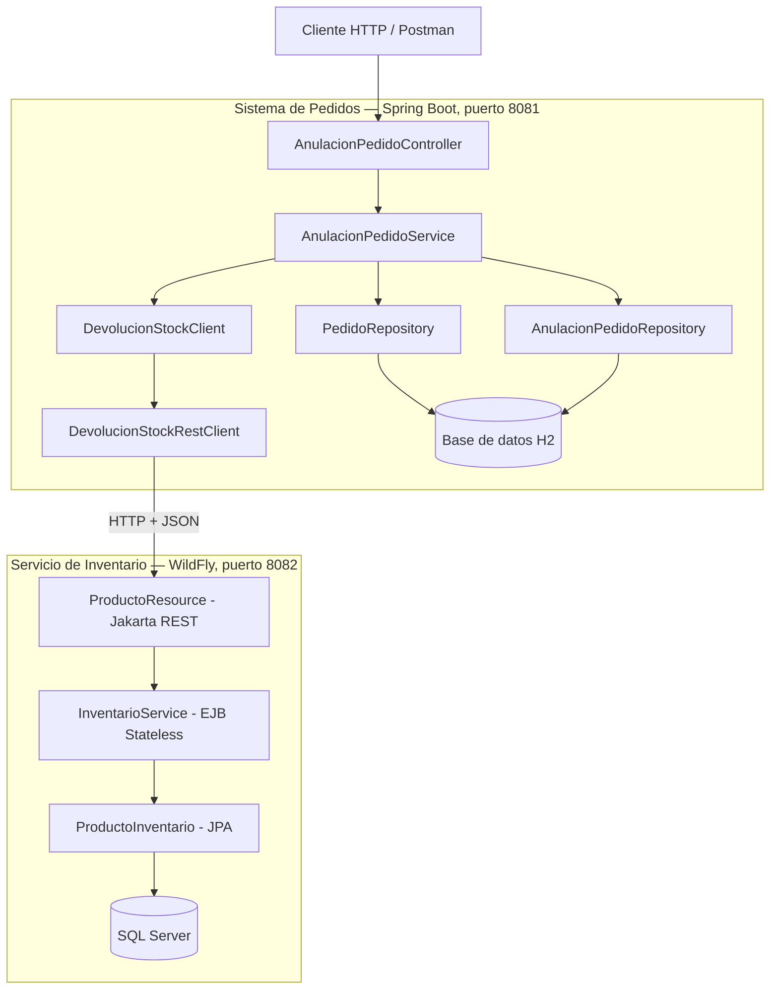

# Diagrama de arquitectura — PA2

## Descripción del flujo

1. El cliente envía una solicitud HTTP para anular un pedido.
2. `AnulacionPedidoController` recibe la solicitud y delega la operación a `AnulacionPedidoService`.
3. El servicio valida el pedido y utiliza `DevolucionStockClient` para solicitar la devolución del stock.
4. `DevolucionStockRestClient` envía la solicitud HTTP al servicio de inventario.
5. `ProductoResource` recibe la solicitud y delega la operación a `InventarioService`.
6. El servicio de inventario actualiza las existencias en SQL Server.
7. Si la devolución se confirma, el servicio de pedidos cambia el estado a `ANULADO` y registra la auditoría en H2.

**Límite transaccional:** la transacción local de Spring administra los cambios de H2. La llamada HTTP a WildFly no forma parte de esa misma transacción distribuida.
